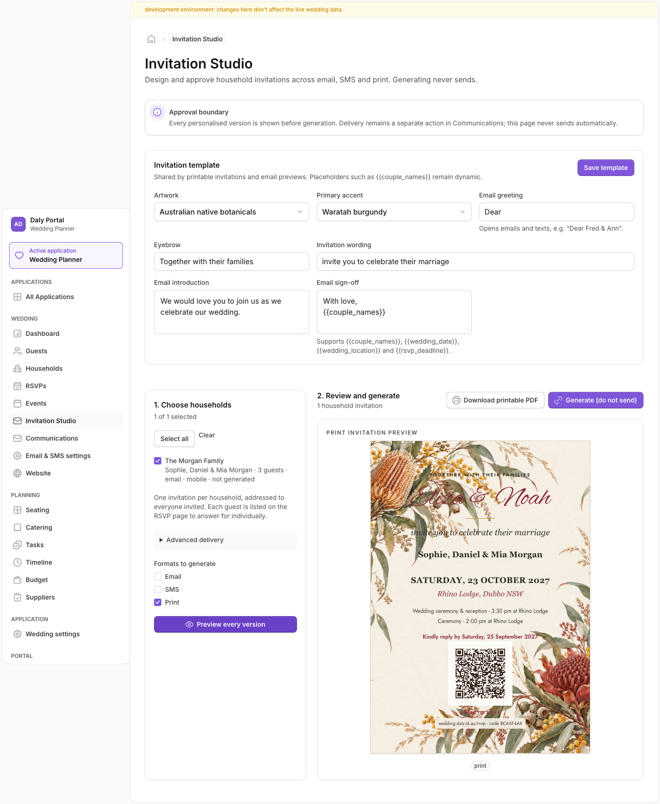
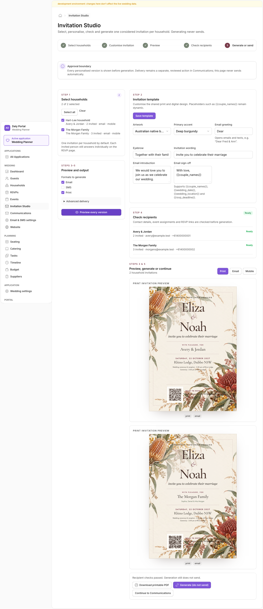
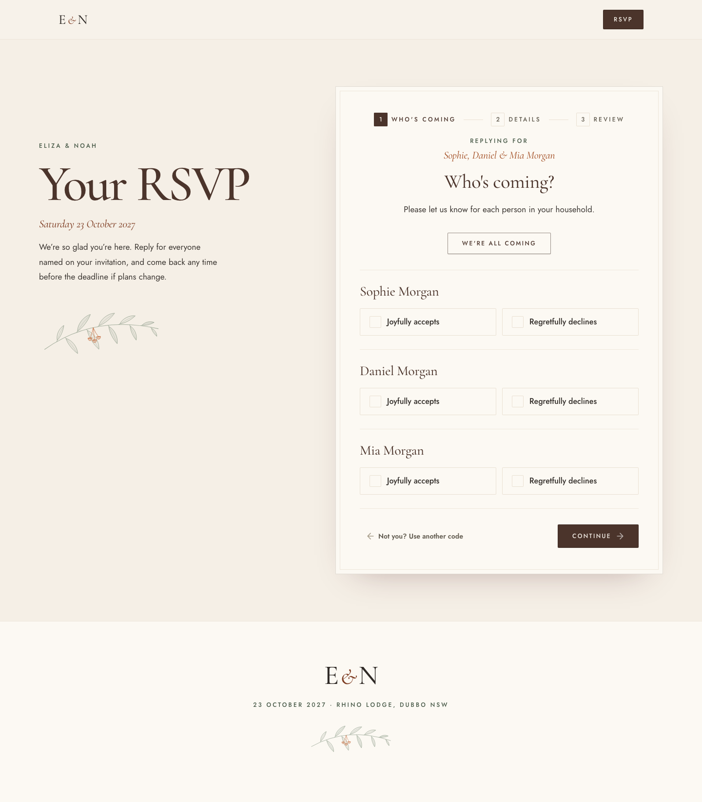
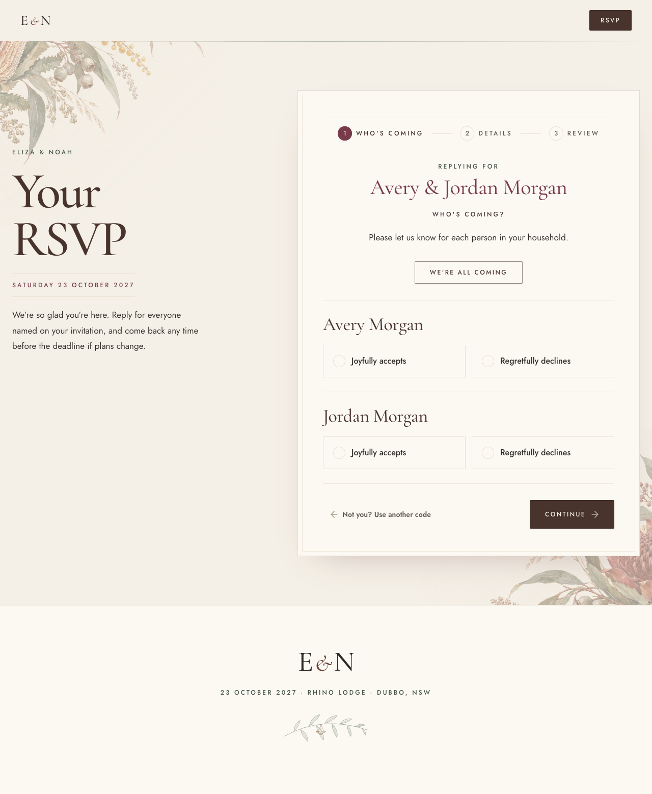
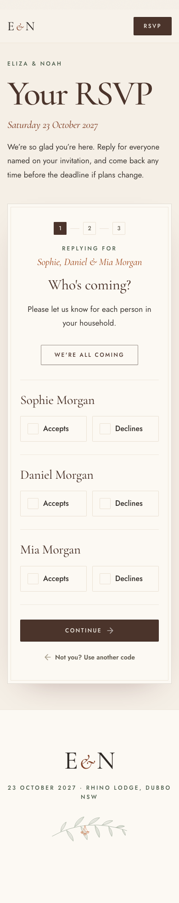
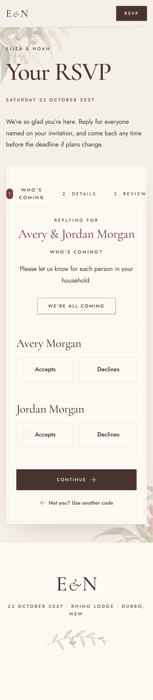
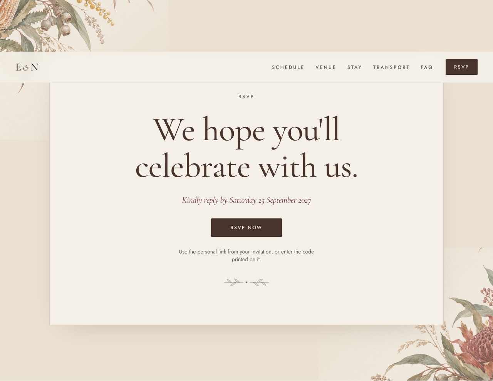
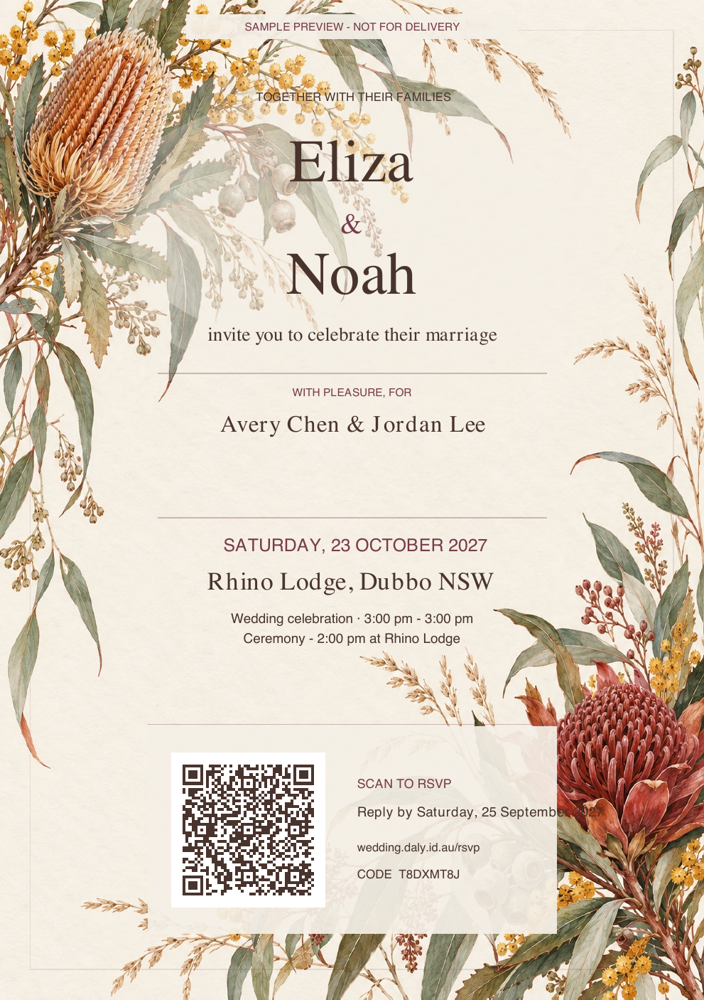
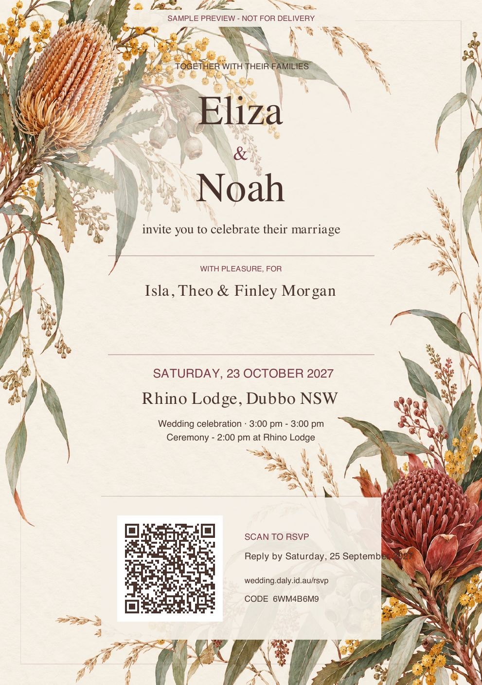
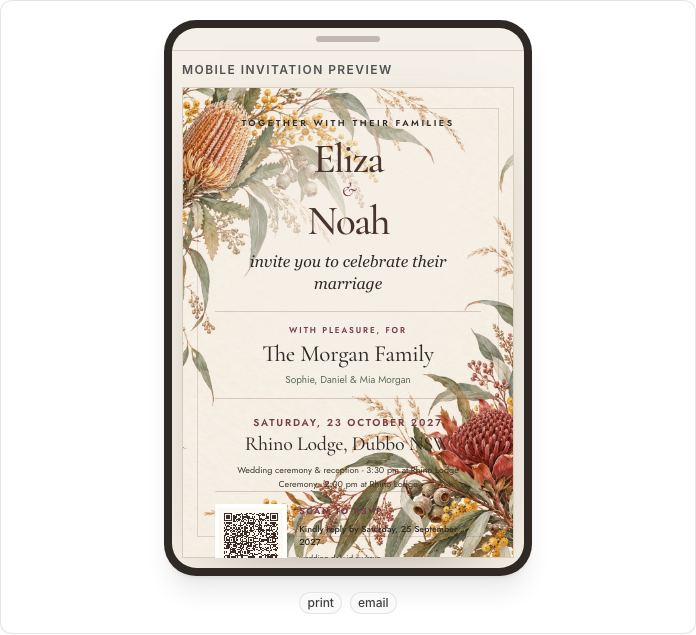

# Modern luxury wedding invitation system

This refinement carries the existing Australian-native identity through the printable invitation, digital previews, Invitation Studio and guest RSVP. It preserves household addressing, optional invited-person lists, signed links, invitation codes and personalised QR codes.

## Design specification

- **Mood:** understated Australian country-estate luxury; warm, editorial and botanical without ornate flourishes.
- **Palette:** warm ivory `#F5F0E7`, espresso `#49342D`, deep burgundy `#783B4A`, muted clay `#9C765C` and eucalyptus `#798676`.
- **Type:** Cormorant Garamond for high-contrast display typography and Jost for functional details. Couple names use the editorial serif, not a cursive wedding font.
- **Composition:** generous negative space, fine matte rules, central alignment on stationery, and the existing native botanical frame kept outside the primary reading column.
- **Signature botanical system:** the original Australian native painting is the master artwork across print and screen. Art-directed crops place its banksia, wattle and eucalyptus in the upper-left and its waratah and gumnuts in the lower-right. Soft diagonal masks end each arrangement before the reading column; there are no generated floral replacements, stock clip art, heavy borders or faux metallic effects.
- **Invitation hierarchy:** couple names → household recipient → date and Rhino Lodge → event details → RSVP action. Date and venue form one scannable block; the QR, deadline, short address and code form another.
- **RSVP hierarchy:** invited household name → current step → each guest → large individual attendance choices. Errors use a high-contrast left rule; completion remains calm and explicit.
- **Studio flow:** Select households → Customise invitation → Preview → Check recipients → Generate or send. Print, email and mobile presentation modes share the same personalised invitation data.
- **Accessibility:** espresso and burgundy are used for functional text on ivory; eucalyptus is decorative or backed by darker text. Controls have at least a 56px touch target, inputs remain at 16px or larger on iPhone, focus treatments remain visible and reduced-motion behavior is unchanged.

## Before and after

| Surface                 | Before                                                 | After                                                                               |
| ----------------------- | ------------------------------------------------------ | ----------------------------------------------------------------------------------- |
| Invitation Studio       |  |                                 |
| RSVP desktop            |         |                                        |
| RSVP mobile             |           |                                          |
| Website RSVP invitation | Existing abstract colour washes                        |  |

The same illustration now behaves like ink on paper rather than a graphic layer: the artwork is full-bleed on A5 stationery, selectively cropped at website edges, quietened behind the RSVP experience, and always kept outside functional text and controls.

## Fictional invitation examples

| Couple invitation                                                           | Family invitation                                                            |
| --------------------------------------------------------------------------- | ---------------------------------------------------------------------------- |
|  |  |

The Studio also includes a phone-framed preview for the family example:

The matching two-page A5 print artifact is [wedding-invitation-examples.pdf](../../../output/pdf/wedding-invitation-examples.pdf).

## Recipient safeguards

The Studio derives readiness from the household data it already receives. It identifies:

- a selected email or SMS channel with no matching contact detail;
- a household with no guest assigned to an RSVP-enabled event;
- a revoked household invitation link; and
- an environment that cannot create valid signed RSVP links.

Preview remains available when only a contact method is missing, so wording can still be reviewed. Generation is disabled until all selected-recipient issues are resolved. Sending remains a separate action in Communications.

## Cloudflare Workers performance

- The website and public RSVP reuse the existing 617 KB botanical JPEG and add no client dependency. The two CSS corner crops resolve to one cacheable asset URL, so they do not duplicate the transfer; repeat visits and movement between website and RSVP use the browser cache.
- The invitation preview reuses that same cached botanical JPEG and the existing QR data URL. Print, email and phone frames add no further artwork assets.
- Recipient checks are computed in the browser from the existing Studio payload, so they add no D1 queries or Worker round trips.
- PDF generation still streams one existing artwork fetch into `pdf-lib` and builds one A5 page per invitation. Removing the cursive embedded font eliminates one asset fetch and font-subsetting step from each PDF request.
- Signed-token generation, QR error correction, invitation codes, D1 artifact writes and pagination are unchanged.

## Verification

- The example PDF is two A5 pages (`419.53 × 595.28 pt`) with one invitation per page.
- Both pages were rendered through Poppler and visually checked for margins, clipping, typography and botanical placement.
- Desktop and iPhone-sized captures verify that the art-directed corner crops frame rather than obstruct website and RSVP content.
- The rendered QR was decoded from the final PDF and resolved to the signed `/rsvp?invite=…` URL.
- Automated verification covers TypeScript, style tokens, unit tests, Worker dry-run build and desktop/mobile Playwright flows.
